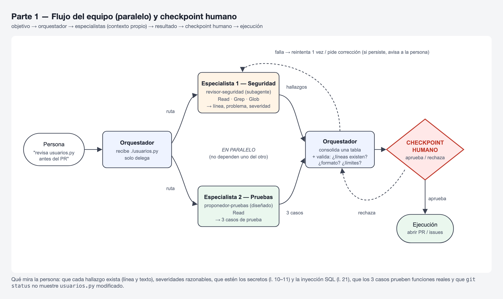
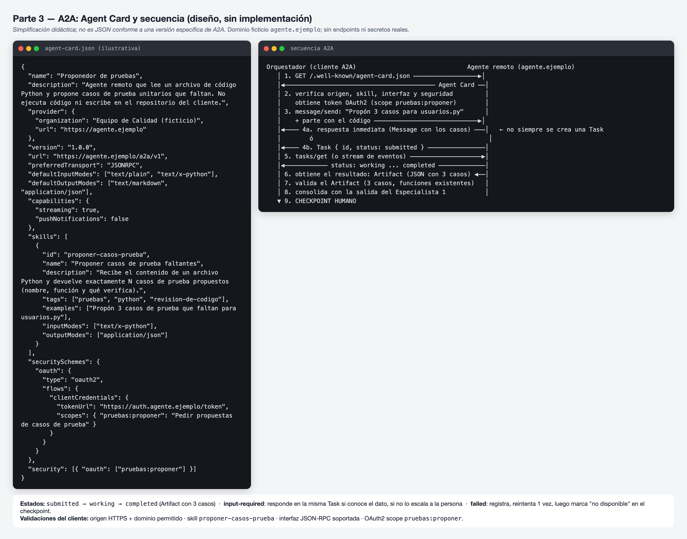

# Equipo de agentes — revisión de `usuarios.py` antes de un pull request

**Tarea:** antes de abrir un pull request, revisar el archivo `usuarios.py` (raíz de este repositorio,
ruta exacta: `./usuarios.py`). El archivo **no se modifica**.

## Parte 1 — Equipo y flujo

| Agente | Misión | Herramientas autorizadas | Entrada | Salida | Límites |
|---|---|---|---|---|---|
| Orquestador | repartir la revisión de `./usuarios.py` entre los dos especialistas y consolidar sus resultados | ninguna propia (solo delega a los especialistas) | ruta del archivo: `./usuarios.py` | una tabla con los hallazgos de seguridad y los 3 casos de prueba, lista para el checkpoint humano | no modifica archivos; no agrega hallazgos propios; no abre el PR sin aprobación humana |
| Especialista 1 — Seguridad (`revisor-seguridad`) | buscar en `./usuarios.py` claves, contraseñas o tokens escritos en el código y entradas de usuario sin validar (p. ej. SQL armado concatenando texto) | leer y buscar (`Read`, `Grep`, `Glob` en Claude Code) | ruta del archivo: `./usuarios.py` | lista/tabla: línea, texto citado, problema, severidad (alta/media/baja), recomendación | solo ese archivo; no escribe ni modifica nada; no copia secretos completos; cada hallazgo cita una línea real |
| Especialista 2 — Pruebas (`proponedor-pruebas`, solo diseñado) | proponer 3 casos de prueba que faltan para `./usuarios.py` (hoy el repositorio no tiene ninguna prueba) | leer (`Read`) | ruta del archivo: `./usuarios.py` | lista de 3 casos: nombre del caso, función que prueba y qué verifica | solo propone; no escribe archivos de prueba; no ejecuta código; exactamente 3 casos |

### 1. Diagrama del flujo (paralelo)

Los dos especialistas **no dependen uno del otro**, así que corren **en paralelo**. El orquestador espera a ambos,
consolida y se detiene en el **checkpoint humano** antes de cualquier ejecución (abrir el PR o corregir el código).

```mermaid
flowchart LR
    P([Persona: "revisa usuarios.py antes del PR"]) --> O[Orquestador<br/>recibe ./usuarios.py]
    O -- ruta del archivo --> S1[Especialista 1<br/>Seguridad<br/>Read · Grep · Glob]
    O -- ruta del archivo --> S2[Especialista 2<br/>Pruebas<br/>Read]
    S1 -- lista de hallazgos --> C[Orquestador consolida<br/>tabla única]
    S2 -- 3 casos de prueba --> C
    C --> V{Validación automática<br/>¿líneas existen? ¿formato? ¿límites?}
    V -- falla --> R[Reintenta una vez<br/>o pide corrección]
    R --> S1
    R --> S2
    V -- ok --> H{{CHECKPOINT HUMANO<br/>la persona aprueba o rechaza}}
    H -- rechaza --> O
    H -- aprueba --> E([Ejecución: abrir PR / crear issues de corrección])
```



### 2. Qué mira la persona antes de aprobar

En el checkpoint humano la persona recibe la tabla consolidada y comprueba:

- **Que cada hallazgo exista en el código:** abre `usuarios.py` en la línea indicada y verifica que el texto citado sea
  el mismo (por ejemplo, la línea 21 de verdad arma el `SELECT` con `+ nombre +`).
- **Que la severidad sea razonable:** una clave escrita en el código o una inyección SQL es alta; la falta de validación
  de formato del correo es baja.
- **Que no falte algo evidente:** las dos constantes de las líneas 10 y 11 y la consulta de la línea 21 tienen que aparecer.
- **Que los 3 casos de prueba tengan sentido:** que prueben funciones que existen (`buscar_usuario`,
  `calcular_descuento`, `crear_usuario`, `es_admin`) y que verifiquen un comportamiento concreto.
- **Que nadie tocó archivos:** `git status` no muestra `usuarios.py` modificado.

**Motivos de rechazo:** un hallazgo en una línea que no existe o con texto que no coincide; un secreto copiado completo
en la salida; un caso de prueba para una función inventada o que no verifica nada (por ejemplo, "probar que el archivo
compila"); más o menos de 3 casos; cualquier archivo modificado.

### 3. Cómo detecto que un especialista falló y qué hace el orquestador

| Señal de fallo | Cómo se detecta | Qué hace el orquestador |
|---|---|---|
| Salida vacía o sin la línea `Total: N hallazgos` | se comprueba el formato de la respuesta | reintenta **una vez** con la misma entrada; si vuelve a fallar, avisa a la persona |
| Inventa líneas | para cada hallazgo, compara la línea y el texto citado con el archivo real (el archivo tiene 42 líneas) | descarta el hallazgo, pide corrección al especialista y lo marca como "no verificado" en la tabla |
| Ignora un límite (revisa otro archivo, intenta escribir, copia un secreto completo) | ruta distinta en la salida, intento de herramienta no autorizada (el harness lo bloquea y queda en el registro), valor completo de `API_KEY` en el texto | no usa esa salida; reintenta con la instrucción del límite reforzada y avisa a la persona |
| Especialista 2 devuelve ≠ 3 casos o casos para funciones que no existen | cuenta los casos y busca el nombre de la función en el archivo | pide corrección indicando qué falta |
| Un especialista no termina (tiempo agotado) | sin respuesta tras el tiempo límite | entrega la parte disponible marcando claramente la que falta; **nunca** la rellena él mismo |

El orquestador nunca "completa" por su cuenta el trabajo de un especialista: si después del reintento sigue fallando,
la decisión pasa a la persona en el checkpoint.

---

## A2A

**Escenario:** el Especialista 2 (Pruebas) ahora pertenece a **otro equipo/empresa** y corre en otro servidor. Mi
orquestador ya no lo invoca como subagente local; lo **descubre** y le **delega** una tarea con A2A.

### 1. Agent Card ilustrativa

> *Simplificación didáctica; no es JSON conforme a una versión específica de A2A.*

```json
{
  "name": "Proponedor de pruebas",
  "description": "Agente remoto que lee un archivo de código Python y propone casos de prueba unitarios que faltan. No ejecuta código ni escribe en el repositorio del cliente.",
  "provider": {
    "organization": "Equipo de Calidad (ficticio)",
    "url": "https://agente.ejemplo"
  },
  "version": "1.0.0",
  "url": "https://agente.ejemplo/a2a/v1",
  "preferredTransport": "JSONRPC",
  "defaultInputModes": ["text/plain", "text/x-python"],
  "defaultOutputModes": ["text/markdown", "application/json"],
  "capabilities": {
    "streaming": true,
    "pushNotifications": false
  },
  "skills": [
    {
      "id": "proponer-casos-prueba",
      "name": "Proponer casos de prueba faltantes",
      "description": "Recibe el contenido de un archivo Python y devuelve exactamente N casos de prueba propuestos (nombre, función y qué verifica).",
      "tags": ["pruebas", "python", "revision-de-codigo"],
      "examples": ["Propón 3 casos de prueba que faltan para usuarios.py"],
      "inputModes": ["text/x-python"],
      "outputModes": ["application/json"]
    }
  ],
  "securitySchemes": {
    "oauth": {
      "type": "oauth2",
      "flows": {
        "clientCredentials": {
          "tokenUrl": "https://auth.agente.ejemplo/token",
          "scopes": { "pruebas:proponer": "Pedir propuestas de casos de prueba" }
        }
      }
    }
  },
  "security": [{ "oauth": ["pruebas:proponer"] }]
}
```

La tarjeta **anuncia** quién es el agente, qué skill ofrece, dónde recibe solicitudes y qué seguridad exige.
**No ejecuta tareas ni demuestra que el agente sea confiable**: es una declaración del propio agente.

### 2. Dónde se obtiene la tarjeta y qué valida el cliente

**Obtención:** `GET https://agente.ejemplo/.well-known/agent-card.json` (ruta bien conocida), o bien desde un
**registro interno** de agentes aprobados por mi organización, o desde una URL que el otro equipo nos comparta.
Prefiero el registro: así solo se descubren agentes que alguien ya aprobó.

**Validaciones del cliente (orquestador) antes de delegar:**

1. **Origen:** la tarjeta llega por HTTPS desde el dominio esperado (`agente.ejemplo`), el certificado es válido y el
   dominio está en una lista de permitidos. Si hay firma de la tarjeta, se verifica.
2. **Skill adecuada:** existe una skill (`proponer-casos-prueba`) cuya descripción y `inputModes/outputModes` encajan con
   lo que necesito (enviar código Python, recibir JSON).
3. **Interfaz:** el `url` del endpoint es HTTPS, pertenece al mismo dominio y uso un transporte que mi cliente soporta
   (JSON-RPC). Si pido streaming, compruebo `capabilities.streaming`.
4. **Autenticación requerida:** veo que exige OAuth2 con el scope `pruebas:proponer`; obtengo el token por el canal de mi
   organización (nunca lo pongo en el código ni en el prompt) y pido **solo** ese scope.
5. **Política de datos:** decido qué envío. Solo el contenido de `usuarios.py`, **sin** el repositorio completo. (Como
   el archivo tiene claves de ejemplo, en un caso real las enmascararía antes de enviarlo a otra empresa.)

### 3. Secuencia

```text
Orquestador (cliente A2A)                               Agente remoto (agente.ejemplo)
   │ 1. GET /.well-known/agent-card.json ──────────────────▶│
   │◀────────────────────────────────────────── Agent Card ──│
   │ 2. verifica origen, skill, interfaz y seguridad         │
   │    obtiene token OAuth2 (scope pruebas:proponer)        │
   │ 3. message/send: "Propón 3 casos para usuarios.py"      │
   │    + parte con el código ─────────────────────────────▶│
   │◀──── 4a. respuesta inmediata (Message con los casos) ───│   ← no siempre se crea una Task
   │        ó                                                 │
   │◀──── 4b. Task { id, status: submitted } ────────────────│
   │ 5. tasks/get (o stream de eventos) ────────────────────▶│
   │◀──────────── status: working ... completed ─────────────│
   │ 6. obtiene el resultado: Artifact (JSON con 3 casos) ◀──│
   │ 7. valida el Artifact (3 casos, funciones existentes)   │
   │ 8. consolida con la salida del Especialista 1           │
   ▼ 9. CHECKPOINT HUMANO                                     
```



### 4. Estados de la Task

**Camino simplificado:** `submitted → working → completed`.

- `submitted`: el agente remoto aceptó la solicitud y creó la Task (tengo su `id`).
- `working`: la está procesando; con streaming recibo actualizaciones, sin streaming consulto con `tasks/get`.
- `completed`: terminó; la Task trae el **Artifact** con los 3 casos. Lo valido igual que la salida de un especialista
  local antes de usarlo.

**Caso alternativo 1 — `input-required`:** el agente remoto se detiene y pregunta algo, por ejemplo "¿qué framework de
pruebas usan, `pytest` o `unittest`?". Mi cliente **no inventa** la respuesta si no la conoce: si es un dato de
configuración que ya tengo (usamos `pytest`), responde en la **misma Task** con otro mensaje; si es una decisión que no
me corresponde, la escala a la persona y deja la Task en espera.

**Caso alternativo 2 — `failed`:** la Task terminó con error (por ejemplo, el archivo no es Python válido o el agente
remoto falló). El cliente registra el motivo, **reintenta una sola vez** si el error parece transitorio y, si vuelve a
fallar, entrega la tabla al checkpoint humano con la parte de pruebas marcada como "no disponible — Task fallida",
sin rellenarla.

### 5. Qué cambia frente a mi subagente local

| Aspecto | Subagente local (`.claude/agents/revisor-seguridad.md`) | Agente remoto A2A |
|---|---|---|
| **Interfaz de red** | ninguna: corre dentro del proceso de Claude Code en mi máquina | HTTP(S) + JSON-RPC/streaming hacia otro servidor; latencia, tiempos límite y caídas de red |
| **Descubrimiento** | el harness lee el archivo de `.claude/agents/` al iniciar | Agent Card en `/.well-known/agent-card.json` o en un registro |
| **Interoperabilidad** | solo funciona dentro de Claude Code (formato propio de la herramienta) | cualquier cliente que hable A2A, sin importar el framework o el modelo del otro lado |
| **Permisos** | los impone mi harness: el frontmatter `tools: Read, Grep, Glob` limita lo que puede hacer | no controlo sus herramientas; solo controlo **qué datos le envío** y qué scope le doy al token |
| **Límites de confianza** | mismo usuario, misma máquina, mismo repositorio | otra organización: es un tercero. Su salida es **dato no confiable** y se valida antes de usarla |

**Diferencia con MCP.** MCP conecta a un agente con **herramientas y recursos** (leer un archivo, consultar una base de
datos, llamar a una API); A2A conecta a un agente con **otro agente** que razona y trabaja de forma autónoma. Si mi
orquestador necesita **acceder directamente** a archivos o datos, usa una herramienta local o una expuesta por un
servidor MCP. Si necesita **delegar una revisión completa** a un agente que vive en otra organización, usa A2A. La
elección depende de **la arquitectura y la interfaz de comunicación**, no de que la tarea "sea leer archivos": el
agente remoto puede usar internamente MCP para leer código, y eso no convierte su conexión conmigo en MCP.

**Recordatorios:** descubrir un agente no implica confiar en él, y no toda comunicación entre agentes es A2A (mi
subagente local se comunica con el agente principal, pero **no** usa A2A).
