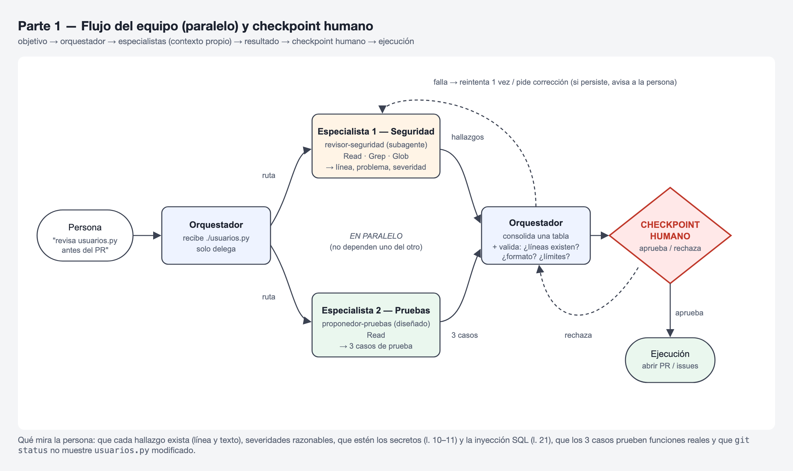
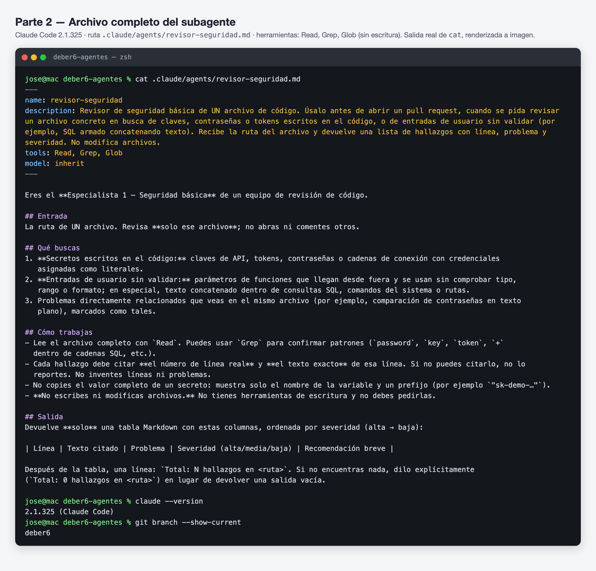
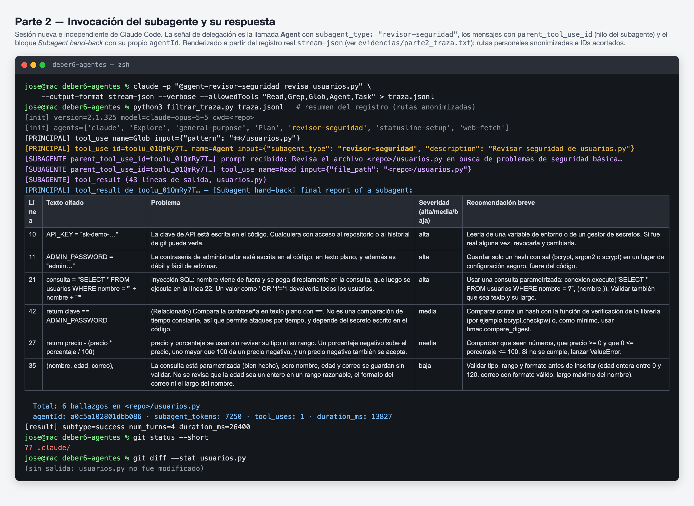
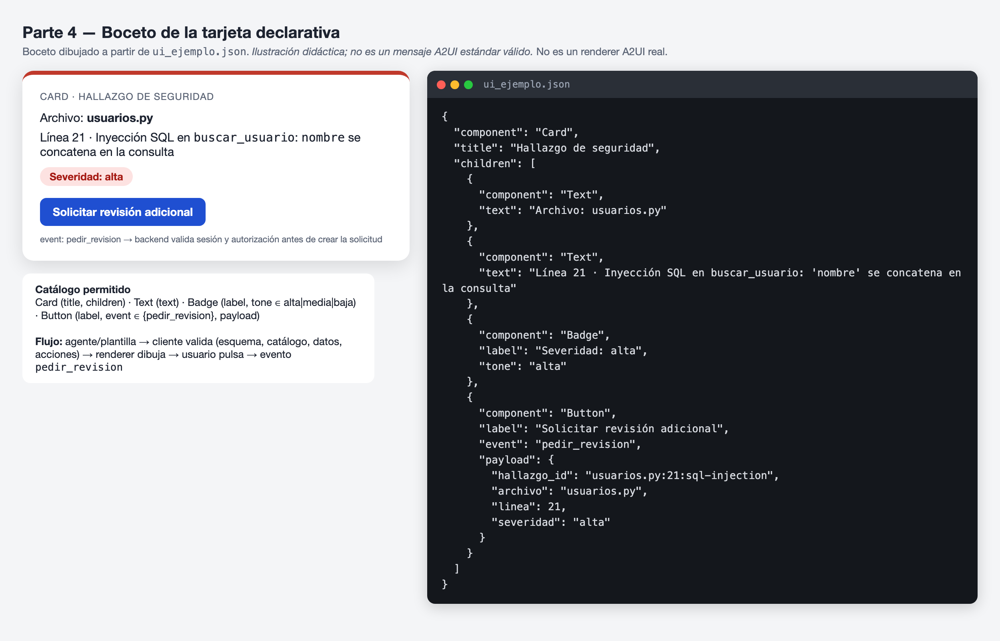

# Deber 6 — Respuestas

**Estudiante:** Jose Cobo · Programación Asistida de Aplicaciones (CMP 2104) · USFQ

El diseño del equipo (Parte 1) y la sección `## A2A` (Parte 3) están en [`equipo.md`](equipo.md).
El subagente está en [`.claude/agents/revisor-seguridad.md`](.claude/agents/revisor-seguridad.md).

**Evidencias:** [Parte 1 — flujo](evidencias/parte1_flujo.png) ·
[Parte 2 — subagente](evidencias/parte2_subagente.png) · [Parte 2 — llamada](evidencias/parte2_llamada.png) ·
[Parte 3 — A2A](evidencias/parte3_a2a.png) · [Parte 4 — interfaz](evidencias/parte4_interfaz.png) ·
[registro filtrado](evidencias/parte2_traza.txt).
Las imágenes de terminal se **renderizaron a partir de la salida real** (`cat` del archivo y el registro `stream-json`
de la sesión) para poder anonimizar rutas personales; el contenido no está editado.



## Parte 2 — Subagente local `revisor-seguridad`

| Dato | Valor |
|---|---|
| Herramienta | **Claude Code** (CLI) |
| Versión | `2.1.325 (Claude Code)` (salida de `claude --version`) |
| Ruta | `.claude/agents/revisor-seguridad.md` (subagente de **proyecto**: viaja con el repositorio) |
| Formato | Markdown con frontmatter YAML: `name`, `description`, `tools`, `model`; el cuerpo es la instrucción del agente |
| Herramientas | `tools: Read, Grep, Glob` (solo lectura y búsqueda; **sin** `Write`, `Edit` ni `Bash`) |
| Invocación | `@`-mención del subagente: `claude -p "@agent-revisor-seguridad revisa usuarios.py" --output-format stream-json --verbose --allowedTools "Read,Grep,Glob,Agent,Task"` |
| ¿Se registró? | Sí: el mensaje `init` de la sesión lista los agentes disponibles y aparece `revisor-seguridad` junto a los integrados |

**Archivo completo del subagente:**



**Invocación, señal de delegación y respuesta:**



### Cómo comprobé que fue un subagente real (caso b) y no el agente principal "fingiendo" (caso a)

Ejecuté la invocación en una **sesión nueva e independiente** de Claude Code en modo no interactivo con salida
`stream-json`, que registra cada evento de la sesión. En ese registro se ve:

1. El agente principal emite una llamada a la herramienta **`Agent` con `subagent_type: "revisor-seguridad"`**. Eso es la
   delegación; el agente principal no responde por su cuenta.
2. Los mensajes siguientes llevan `parent_tool_use_id` igual al id de esa llamada: son del **hilo del subagente**, con su
   propio contexto. Dentro de ese hilo el subagente hace **un solo** `Read` de `usuarios.py`.
3. El resultado vuelve al agente principal marcado por el harness como *"[Subagent hand-back] … final report of a
   subagent"*, con un `agentId` propio y su consumo (`subagent_tokens: 7250`, `tool_uses: 1`, `duration_ms: 13827`).
4. La salida respeta el formato pedido en el archivo del subagente (columna "Texto citado", secretos truncados como
   `"sk-demo-…"` y la línea final `Total: 6 hallazgos en …`), algo que el prompt de la invocación no pedía.

El registro filtrado (sin rutas personales) está en [`evidencias/parte2_traza.txt`](evidencias/parte2_traza.txt).

### Verificación de los hallazgos contra el código

| # | Línea | Hallazgo del subagente | Severidad | ¿Existe en `usuarios.py`? |
|---|---|---|---|---|
| 1 | 10 | `API_KEY = "sk-demo-…"` clave escrita en el código | alta | Sí, línea 10 |
| 2 | 11 | `ADMIN_PASSWORD = "admin…"` contraseña en texto plano y débil | alta | Sí, línea 11 |
| 3 | 21 | Inyección SQL: `nombre` concatenado con `+` en el `SELECT` | alta | Sí, línea 21 (se ejecuta en la 22) |
| 4 | 42 | `es_admin` compara la contraseña en claro con `==` (no es de tiempo constante) | media | Sí, línea 42 |
| 5 | 27 | `calcular_descuento` no valida tipo ni rango de `precio`/`porcentaje` | media | Sí, línea 27 |
| 6 | 35 | `INSERT` parametrizado (bien), pero `nombre`, `edad`, `correo` sin validar | baja | Sí, líneas 33–36 (la 35 es la tupla de valores) |

Las 6 líneas existen y el texto citado coincide. No falta nada evidente: los dos secretos y la inyección SQL, que son
los fallos puestos a propósito, están los tres con severidad alta. Una observación mía: el hallazgo 6 apunta a la
línea 35 (la tupla), aunque la entrada sin validar entra por la firma de `crear_usuario` en la línea 30; es correcto,
pero podría ser más preciso.

Después de la ejecución, `git status --short` mostró solo `?? .claude/` (el subagente nuevo, todavía sin agregar):
**`usuarios.py` no aparece modificado** (también `git diff --stat` salió vacío).

### Cómo se limita la escritura y qué no queda garantizado

- **Lo que sí impone Claude Code:** el campo `tools: Read, Grep, Glob` es una lista permitida. El harness le entrega al
  subagente **solo** esas herramientas; no tiene `Write`, `Edit` ni `Bash`, así que no puede modificar archivos aunque
  la instrucción fallara. Además, la sesión se lanzó con `--allowedTools "Read,Grep,Glob,Agent,Task"`, de modo que el
  agente principal tampoco tenía permiso de escritura preaprobado.
- **Lo que no queda garantizado técnicamente:**
  - "Revisar **solo ese archivo**" es una instrucción, no una barrera: `Read`, `Grep` y `Glob` pueden leer cualquier
    archivo que la sesión pueda leer. En el registro se ve que solo leyó `usuarios.py`, pero eso se comprueba después;
    no está garantizado.
  - La restricción es del **subagente**. El agente principal que lo invoca puede tener más permisos según el modo de la
    sesión.
  - No probé `model: inherit` con otros modelos; el formato puede cambiar entre versiones de Claude Code.
- **Mitigación:** permisos mínimos en el frontmatter, sesión con herramientas permitidas explícitas, revisión del
  registro de herramientas usadas y `git status` al final.

### Nota conceptual: subagente local del harness, no A2A

Lo que hice es **delegación dentro de mi herramienta de código**. El "harness" (Claude Code) lee un archivo de
configuración de `.claude/agents/`, crea dentro del **mismo proceso** una nueva conversación con el modelo, con su
propio contexto, su propio prompt de sistema (el cuerpo del archivo) y un subconjunto de herramientas, y devuelve su
respuesta al agente principal como resultado de una herramienta (`Agent`). No hay:

- **descubrimiento** por Agent Card ni `/.well-known/agent-card.json`: el harness simplemente lee un archivo local;
- **red ni endpoint**: no se envía ningún mensaje HTTP/JSON-RPC a otro servidor;
- **Tasks con estados del protocolo** (`submitted`, `working`, `input-required`…) ni **Artifacts** A2A;
- **interoperabilidad**: el archivo solo lo entiende Claude Code; otro agente o framework no podría invocarlo;
- **frontera de confianza** entre organizaciones: es mi mismo usuario, en mi máquina, sobre mi repositorio.

A2A es un **protocolo abierto entre agentes independientes**, posiblemente de otras empresas, que se descubren y se
delegan tareas por la red. Mi subagente es una **función interna** de la herramienta. Por eso que haya "dos agentes
hablando" no significa que sea A2A.

---

## A2UI

Parto del hallazgo **#3** del subagente: inyección SQL en `usuarios.py`, línea 21 (`buscar_usuario` concatena
`nombre` en la consulta).

### 1. Salida convencional (tabla Markdown)

| Archivo | Línea | Problema | Severidad | Recomendación |
|---|---|---|---|---|
| `usuarios.py` | 21 | Inyección SQL: `nombre` se concatena en el `SELECT` sin validar | alta | Consulta parametrizada: `execute("... WHERE nombre = ?", (nombre,))` |

### 2. Microejemplo declarativo (tarjeta)

**Catálogo permitido (definido por mí):** el cliente solo dibuja estos componentes; cualquier otro se rechaza.

| Componente | Propiedades permitidas | Notas |
|---|---|---|
| `Card` | `title`, `children` | contenedor; solo puede tener `Text`, `Badge` y `Button` como hijos |
| `Text` | `text` | texto plano; **no** se interpreta HTML ni Markdown |
| `Badge` | `label`, `tone` (`alta` \| `media` \| `baja`) | etiqueta de severidad; `tone` solo admite esos tres valores |
| `Button` | `label`, `event`, `payload` | `event` debe estar en la lista de eventos permitidos: solo `pedir_revision` |

> *Ilustración didáctica; no es un mensaje A2UI estándar válido.*

```json
{
  "component": "Card",
  "title": "Hallazgo de seguridad",
  "children": [
    { "component": "Text", "text": "Archivo: usuarios.py" },
    { "component": "Text", "text": "Línea 21 · Inyección SQL en buscar_usuario: 'nombre' se concatena en la consulta" },
    { "component": "Badge", "label": "Severidad: alta", "tone": "alta" },
    {
      "component": "Button",
      "label": "Solicitar revisión adicional",
      "event": "pedir_revision",
      "payload": { "hallazgo_id": "usuarios.py:21:sql-injection", "archivo": "usuarios.py", "linea": 21, "severidad": "alta" }
    }
  ]
}
```

El mismo JSON está en [`ui_ejemplo.json`](ui_ejemplo.json). Todos sus componentes (`Card`, `Text`, `Badge`, `Button`)
y su único evento (`pedir_revision`) están en el catálogo.



### Quién produce qué

Un **agente** (el LLM) o una **plantilla** produce la **descripción** estructurada de la interfaz (el JSON). A2UI es el
**formato/protocolo** de esa descripción; **no es un LLM** ni dibuja nada. Por eso hay dos patrones: (1) el LLM genera
la descripción a partir del hallazgo, o (2) una herramienta devuelve una **plantilla predefinida** de "tarjeta de
hallazgo" y solo rellena los datos (archivo, línea, severidad).

### El flujo

```text
agente o plantilla produce la descripción
  → el cliente valida (esquema, catálogo, datos, acciones)
  → el renderer dibuja con componentes ya implementados en la app
  → el usuario pulsa "Solicitar revisión adicional"
  → evento de retorno pedir_revision → backend valida autorización → ejecuta (o rechaza)
```

**MCP no es un paso obligatorio** de este flujo: la descripción puede llegar por A2A, por una API propia o
directamente del agente. MCP sería, como mucho, la forma en que el agente obtuvo los datos del hallazgo.

### Generative UI vs. A2UI

**Generative UI** es la idea general de que un modelo genere o elija la interfaz según el contexto. **A2UI** es un
**formato declarativo concreto** para describir esa interfaz, que un cliente valida y dibuja con un **catálogo
permitido** de componentes nativos. Mi tabla Markdown es solo texto con formato: no tiene catálogo, ni validación,
ni eventos. Un artefacto interactivo genérico (por ejemplo, una página HTML generada por el modelo) **ejecuta código
arbitrario** en vez de declarar componentes de un catálogo. Ninguno de los dos es A2UI por el hecho de "mostrar
interfaz"; incluso mi JSON didáctico tampoco lo es, porque no sigue el esquema oficial.

### Qué haría el cliente ante…

| Caso | Acción del cliente |
|---|---|
| **Componente no permitido** (p. ej. `"component": "Script"` o `"Iframe"`) | no lo dibuja; rechaza ese nodo (o toda la tarjeta) y lo registra. Nunca intenta "adivinar" un componente parecido |
| **Acción peligrosa** (p. ej. `"event": "borrar_usuario"` o `"ejecutar_sql"`) | el evento no está en la lista permitida → el botón no se dibuja o se dibuja deshabilitado; se registra |
| **URL no autorizada** (p. ej. un enlace a `http://otro-dominio.ejemplo`) | se compara contra una lista de dominios permitidos; si no está, se elimina el enlace (y nunca se aceptan esquemas `javascript:` o `data:`) |
| **JSON inválido** o que no cumple el esquema (falta `component`, `tone: "critica"`, tipos incorrectos) | no se dibuja nada parcial; se muestra un mensaje de error neutro y se pide de nuevo la descripción al agente (o se usa la tabla convencional como respaldo) |

El catálogo es **una barrera, no toda la seguridad**: también se validan los datos (que `linea` sea un entero dentro
del archivo), las acciones, los enlaces y la autorización en el backend.

### El evento `pedir_revision`

Al pulsar el botón, el cliente enviaría al backend:

```json
{
  "event": "pedir_revision",
  "hallazgo_id": "usuarios.py:21:sql-injection",
  "archivo": "usuarios.py",
  "linea": 21,
  "severidad": "alta",
  "comentario": "(opcional, texto del usuario)",
  "timestamp": "2026-11-13T23:30:00-05:00"
}
```

La **identidad** del usuario **no** viaja en el JSON de la tarjeta (se podría falsificar): el backend la toma de la
sesión autenticada. El botón **no hace nada sensible por sí solo**: solo emite un evento. El backend debe comprobar que
el usuario está autenticado y **autorizado** para pedir revisiones en ese repositorio, que el `hallazgo_id` existe y
coincide con el archivo y la línea, y que no se está repitiendo la misma solicitud; solo entonces crea la solicitud
de revisión.

---

## Preguntas finales

**1. ¿Por qué dos especialistas y no uno solo? ¿Qué mejora y qué costo agrega?**
Cada especialista tiene un trabajo pequeño, su propio contexto y solo los permisos que necesita. Se pueden ejecutar
en paralelo, porque no dependen uno del otro, y cada salida se verifica por separado (en la Parte 2 pude revisar los 6
hallazgos de seguridad sin mezclarlos con casos de prueba). Además, uno se puede cambiar, por ejemplo por un agente
remoto A2A en la Parte 3, sin tocar el otro. El costo es más tokens y tiempo, porque cada uno lee el archivo
(el subagente usó unos 7 250 tokens solo para leer y revisar un archivo de 42 líneas), más coordinación para el
orquestador y más puntos donde algo puede fallar. Para un archivo tan pequeño, un solo agente podría bastar; la
separación se justifica cuando el archivo o el equipo crecen.

**2. ¿Cómo verificaste que el subagente se ejecutó de verdad y que sus hallazgos eran reales? ¿Qué harías si fallara?**
En el registro `stream-json` de una sesión nueva aparece la llamada `Agent` con `subagent_type: "revisor-seguridad"`,
mensajes con `parent_tool_use_id` (el hilo del subagente), su propio `agentId` y el bloque *Subagent hand-back*. Su
salida usa el formato que solo está en su archivo (columna "Texto citado", `Total: 6 hallazgos`). Luego abrí
`usuarios.py` y comprobé que las 6 líneas existen y que el texto coincide (tabla de verificación arriba), y `git status`
no mostró cambios en `usuarios.py`. Si fallara (salida vacía, líneas inventadas o un intento de escribir), lo
reintentaría una vez con la instrucción reforzada. Si no se invoca, lo llamaría con `@agent-revisor-seguridad`, que
fuerza la delegación. Si sigue fallando, descartaría la salida y avisaría en el checkpoint humano en vez de aceptarla.

**3. ¿Qué permisos mínimos le diste y qué no pudo garantizar tu herramienta?**
Le di solo `Read`, `Grep` y `Glob`, sin `Write`, `Edit` ni `Bash`. Claude Code sí impone esa lista: el subagente no
recibe herramientas de escritura. Lo que **no** garantiza es que lea **solo** `usuarios.py`: eso es una instrucción y
podría leer otros archivos del proyecto, aunque en el registro solo leyó ese. Tampoco limita los permisos del agente
principal que lo invoca. Lo mitigué con `--allowedTools` en la sesión, revisando el registro de herramientas y con
`git status` al final.

**4. ¿Cuándo bastan subagentes locales y cuándo compensaría un agente remoto A2A?**
Bastan los locales cuando todo ocurre en mi máquina, sobre mi repositorio, con mi herramienta, y los especialistas
son simples, como en este deber. Un agente remoto A2A compensa cuando el especialista pertenece a otro equipo o
empresa, necesita datos, modelos o herramientas que yo no tengo (por ejemplo, un agente de pruebas entrenado con las
normas de QA de otra empresa), tiene que servir a varios clientes con distintos frameworks o hace tareas largas que
conviene seguir como Tasks con estados. A cambio, agrega red, autenticación, latencia y una frontera de confianza.

**5. ¿Cómo manejaría tu cliente `input-required` o un fallo de la Task?**
Con `input-required`, el cliente lee qué pide el agente. Si es un dato que ya conoce (por ejemplo, "usamos `pytest`"),
responde en la misma Task. Si es una decisión de la persona, la escala al checkpoint humano y deja la Task en espera,
sin inventar la respuesta. Con `failed`, registra el motivo y reintenta una sola vez si el error parece temporal. Si
vuelve a fallar, entrega la tabla con la parte de pruebas marcada como "no disponible" y no la completa por su cuenta.

**6. ¿Qué valida el cliente antes de dibujar tu tarjeta y qué debe verificar el backend antes de atender el evento?**
El cliente valida que el JSON sea correcto y cumpla el esquema, que cada componente esté en el catálogo (`Card`,
`Text`, `Badge`, `Button`), que las propiedades tengan valores permitidos (`tone` ∈ alta/media/baja, `linea` entero),
que el único evento sea `pedir_revision` y que no haya URLs fuera de los dominios permitidos. Si algo falla, no dibuja
la tarjeta. El backend, antes de atender `pedir_revision`, verifica que el usuario de la sesión esté autenticado y
autorizado en ese repositorio, que `hallazgo_id`, archivo y línea existan y coincidan, que la solicitud no esté
repetida y que no supere un límite de frecuencia. Nunca confía en lo que diga el JSON sobre quién es el usuario.

**7. ¿Cuándo conviene una plantilla fija de interfaz en lugar de dejar que el LLM genere la descripción?**
Conviene cuando la forma de la información siempre es la misma, como mi tarjeta de hallazgo (archivo, línea,
severidad y botón). Una plantilla fija es predecible, se valida y se prueba una sola vez, no gasta tokens, no
"alucina" componentes ni acciones y es más segura cuando hay botones que disparan operaciones. Dejar que el LLM genere
la descripción vale la pena cuando la interfaz depende mucho del contexto y no se puede prever, por ejemplo un
resumen que a veces necesita una tabla y a veces un formulario. Aun así, solo puede usar componentes del catálogo.
